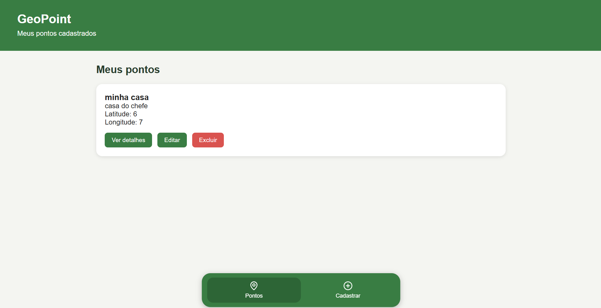

# GeoPoint

Aplicação web desenvolvida em React para gerenciamento de pontos geográficos, consumindo uma API REST.

## Funcionalidades

- Cadastrar pontos geográficos.
- Listar pontos cadastrados.
- Visualizar detalhes de um ponto.
- Editar pontos existentes.
- Excluir pontos.
- Pesquisar pontos pelo nome.

## Tecnologias utilizadas

- React
- JavaScript
- React Router
- CSS
- Fetch API

## Requisitos

- Node.js instalado.
- API GeoPoint em execução.

## Como executar o projeto

1. Clone ou baixe este repositório.
2. Abra o terminal na pasta do projeto.
3. Instale as dependências:

   npm install

4. Inicie a aplicação:

   npm run dev

5. Acesse o endereço apresentado no terminal.

## API

A aplicação consome a API GeoPoint, desenvolvida na aula de Organização e Abstração de Objetos com o professor Luciano.

URL base:
https://geoatlas-nqtx.onrender.com

Certifique-se de que a API esteja em execução antes de utilizar a aplicação.

